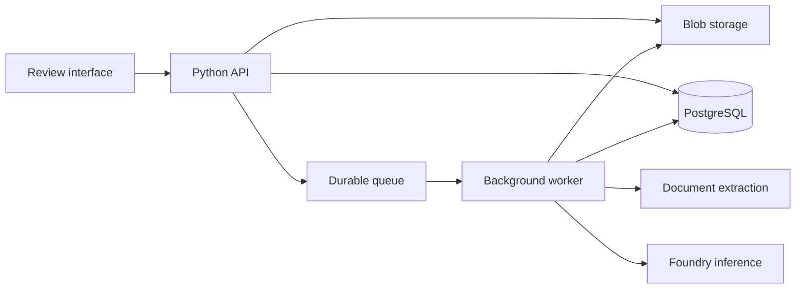

# Financial document AI pipeline

Status: proposed implementation design, 9 November 2026.
Tracking: [AI-200](https://linear.app/ai-platform-portfolio/issue/AI-200/document-the-financial-consistency-application-design).

## System objective

Prove that application engineers can consume reusable platform templates to run
an AI document pipeline with scoped resources, durable execution, bounded
inference consumption, observable database behaviour and evaluated releases.
Document consistency checking is the acceptance workload. This repository owns
its application semantics; the shared repositories own infrastructure templates.

No application code, database schema, infrastructure provisioning or deployment
is delivered by this document. Existing portfolio infrastructure is a dependency,
not evidence that this application's isolation, recovery or capacity is proven.

## Workload and boundaries

A user uploads a financial report and its management summary, starts a review,
and receives findings with evidence from both documents. A reviewer can accept
or dismiss a finding without changing the original result.

Start with repeated financial figures, arithmetic and one bounded narrative
check, such as whether a margin-improvement statement agrees with the figures.
Compare entity, period, currency, scale and accounting basis before treating
different values as inconsistent. Use explicit arithmetic and rounding tolerances.
Missing evidence or ambiguous extraction produces an unresolved result.

Consistency does not establish external correctness. Both documents may agree
and be wrong. Completed processing does not guarantee exhaustive review.
Automatic edits, visual style checking, annotated Office export and general
financial analysis are outside the first implementation.

## Architecture



The API accepts work and serves status/findings. Workers process document
versions independently of HTTP requests. Initially API and worker can share one
backend image with different entry points; they have independently bounded
replicas and connections. A small frontend completes the review journey.

AI infrastructure responsibilities:

| Capability | Workload requirement |
| --- | --- |
| Foundry model deployments | Structured claim extraction and semantic comparison |
| Document extraction | Text, tables, layout and source locations |
| Workload identity and model access | Approved deployments with short-lived credentials |
| Inference capacity controls | Concurrent-call limits, token budgets and throttling recovery |
| AI telemetry and evaluations | Configuration identity, token usage, quality and cost per review |
| Embeddings and vector index, conditional | Related narrative evidence if simpler matching is insufficient |

Foundry supplies managed inference; this design does not require GPU nodes.
Reuse the portfolio's available authenticated inference path. APIM is not a
prerequisite for the first application. Assess existing agent-factory capabilities
before reuse; a fixed worker pipeline does not inherently need a hosted agent.

## Ownership and self-service contract

| Repository | Responsibility |
| --- | --- |
| This application | Code, SQL migrations, evaluation cases, app tests, minimal intent values and thin CI callers |
| application-helm-chart | Reusable workloads, Argo registration, database/identity/credential/RBAC/TLS wiring, resource defaults and lifecycle templates |
| ops-shared | Composable build, validation and publication capabilities |
| gitops | Shared operators, services and configuration installed once; no application registrations or per-app delivery definitions |
| terraform and bootstrap caller | Cluster/bootstrap foundations under existing ownership rules |
| application-library | Existing reusable code capabilities where a concrete consumer need fits |

Applications select components and dependencies through intent. Automation
supplies repository/PR identity; templates derive dependent names. Two PRs in one
repository and the same PR number in another must coexist. Onboarding must not
require shared per-app access lists, copied manifests or manual SQL administration.

Extend templates only for a demonstrated capability gap. Queue, storage and model
intent fields must be designed against existing chart consumers before adoption;
this document does not invent a new values API. Persistent environments use the
existing managed PostgreSQL path; disposable previews follow the established
preview backend and credential policy.

## Processing and data contract

```text
register immutable document versions
  -> preserve layout and source evidence
  -> extract and normalise claims
  -> select comparable claims
  -> deterministic calculations and bounded semantic checks
  -> publish findings and review coverage
```

| Data responsibility | Required information |
| --- | --- |
| Document version | Content hash, storage reference, source identity and extraction version |
| Review | Tenant/access boundary, fixed document pair and check configuration |
| Step/attempt | Processing status, retries, error category and timestamps |
| Evidence | Original text, source version, page/location and table/heading context |
| Claim | Evidence reference, entity, metric/value/unit, period and qualifiers |
| Finding | Check identity, paired evidence, explanation and unresolved/issue classification |
| Reviewer decision | Actor, decision and timestamp, preserving original output |

These responsibilities are a schema starting point, not a fixed table count.
Use relational columns for constrained/queryable facts and JSONB for variable
extraction details. Originals and large extraction artifacts stay in Blob.
Keep transactions short; do not hold database connections during model calls.

A review freezes source and processing identities. Proposed terminal states are
completed, failed or cancelled, with partial/unresolved coverage explicit in the
result. Reprocessing creates a new run rather than rewriting historical evidence.
Exact transitions, uniqueness constraints and cancellation behaviour are the
first schema/API design task.

## Retrieval and model decisions

Group numerical claims by compatible entity, metric and period; application code
performs arithmetic. Preserve source qualifiers alongside normalised facts.
Use models for semantic extraction/comparison with typed, validated outputs.

Begin with a fixed workflow and bounded model calls. Parallel checks are ordinary
tasks; multiple autonomous agents are not required. Add another verification pass
only if held-out evaluation shows sufficient quality improvement for its cost.

Retrieval selects evidence candidates. Top-k search can miss contradictions, so
measure candidate recall separately from classification quality. Compare all
compatible structured claims in small packs where feasible. Introduce embeddings,
pgvector or reranking only when evaluation demonstrates a gap. Extension
availability/allowlisting and schema enablement have distinct platform owners.

## Durability, security and resource bounds

- Persist review/step state and enforce idempotent result publication. Define how
  committed work is delivered to the queue after an API or broker failure; choose
  a supported dispatch/reconciliation mechanism before implementing dual writes.
  Queue notifications alone cannot close that gap. Prefer event-driven delivery.
- Select native messaging clients, Celery with a supported broker, or durable
  workflow tooling against explicit retry, acknowledgement and recovery needs.
  Do not create a general workflow engine for this application.
- A model call can succeed before its result commits. A retry may repeat the
  charge; database idempotency does not make external inference exactly once.
- Bound document sizes, per-stage deadlines, retries, worker concurrency and
  model calls. Provider throttling must not cause uncontrolled worker expansion.
- Cache extraction only for matching tenant, content and extraction version.
  Check-result caches also include all evidence/configuration inputs. Redis is
  optional and never the only authoritative review record.
- Use Entra authentication and scoped workload identities. Test runtime privileges
  through the actual API/worker identities; migrations retain separate ownership.
- Enforce authorisation on queries, object downloads, evidence links and worker
  inputs. Treat document instructions as untrusted data. Default telemetry omits
  source content and credentials; record metadata and authorised diagnostic data.
- Define deletion of originals, artifacts, claims, vectors and caches together.
  Preserve ordered preview cleanup and the portfolio's disposable-data policy.

## Evaluation, observability and database capacity

Use public or independently authored document pairs. Include planted discrepancies,
clean packs, legitimate differences and differently written held-out examples.
Do not use employer documents or proprietary implementation details.

Measure precision/recall by check type, candidate recall, evidence-location
accuracy and unresolved cases. Numerical checks have deterministic oracles;
semantic cases need human-reviewed labels. Model judges supplement these checks.
Reviewer corrections enter a curated evaluation queue, not automatic training.

Trace review -> step -> extraction/model/database operation using configuration
and artifact identities. Track queue age, completion latency, retries, provider
throttles, token usage and cost per acceptable completed review. Evaluation and
production processing share behaviour, but have explicit datasets and boundaries.

Database experiments cover concurrent small reviews, large packs, mixed processing
and findings reads, reprocessing and tenant skew. Measure query plans/latency,
connections, contention and candidate-pair growth. All-pairs comparison grows
quadratically; optimise candidate selection while checking missed discrepancies.

The initial small managed server establishes functional acceptance and a baseline.
Record CPU-credit behaviour for Burstable measurements. Built-in Azure PgBouncer
is unavailable on that tier; assess bounded application pooling first. Worker
replicas do not prove database scaling, and read replicas do not scale writes.
Change capacity only for a measured experiment with a reviewed scope.

Use bounded real model runs for quality/end-to-end evidence and controlled
responses for reproducible infrastructure load; report those results separately.

## Delivery sequence and acceptance

| Milestone | Outcome and gate |
| --- | --- |
| 1. Review persistence | Schema/API contract, restricted database access and worker state; prove duplicate and interrupted work handling using controlled input |
| 2. Document evidence | One selected input format, Blob upload and extraction; verify source locations and extraction ambiguity |
| 3. Consistency checks | Selected numerical checks and one narrative check; labelled positives, negatives and unresolved cases |
| 4. Evaluated delivery | Immutable images/migrations/configurations, held-out evaluation and existing preview/promotion/rollback lifecycle |
| 5. Capacity and recovery | Mixed-load measurements, throttling/backlog recovery, isolation and worker interruption |

Before implementation, agree formats, check definitions, API/state transitions,
extraction service, queue/task tooling and numerical tolerances. Milestone 1 can
use the running server after a focused pre-PR review; design approval does not
authorise database writes or provisioning. Keep existing recovery drills separate.

Each implementation PR presents current evidence, ownership, exact files,
developer intent, template wiring, validation and deployment limits. A second
consumer must use shared templates unchanged. User owns merges and deployments.

## Research informing the design

- [Model ML AutoCheck](https://modelml.com/articles/autocheck-ai-review-for-pitch-decks-and-presentations): financial consistency checking with located evidence; vendor-described behaviour, not an independent quality guarantee.
- [Model ML Composite](https://modelml.com/articles/introducing-the-model-ml-composite): evaluate complete task quality and cost, including tools and retries; proprietary rankings are not universal model recommendations.
- [Azure document tooling comparison](https://devblogs.microsoft.com/foundry/choosing-azure-document-intelligence-and-content-understanding/): compare extraction on representative content and operational requirements.
- [pgvector](https://github.com/pgvector/pgvector): filtered approximate search can reduce candidate coverage.
- [Celery acknowledgement and retry semantics](https://docs.celeryq.dev/en/stable/userguide/tasks.html): worker-loss cases require explicit testing.
- [Azure PostgreSQL pooling](https://learn.microsoft.com/en-us/azure/postgresql/connectivity/concepts-pgbouncer): built-in pooling tier limits.
- [Foundry privacy and processing scope](https://learn.microsoft.com/en-us/legal/cognitive-services/openai/data-privacy): resource location alone does not establish inference processing boundaries.

Research gathered in November 2026. Verify current service/API support, region,
licensing and cost before selecting dependencies.
